# DESIGN

The visual guide of tui-kit. This file is the canonical source both products
(herdr-suite and herdr-utils) follow; the Go packages are its executable form. If
a screen and this document disagree, the screen is wrong.

The rules exist because a TUI is read at a glance, often while the user is doing
something else. Everything here protects three things: **where the eye starts**
(the title, the selected row), **what a colour means** (live, failed, work in
progress), and **the grid** (nothing wraps, nothing floats, no column drifts).

---

## 1. Palette

Tokyo Night, roles only. No screen names a colour; a role is what a row asks for.
Fifteen roles, and they are all of them.

| Role | Value | Means | Never |
| --- | --- | --- | --- |
| text | `#c0caf5` | Prose: names, values, the primary text of a row. | Used for explanation. |
| muted | `#565f89` | Every secondary fact: workspace, counts, age, path, hint label. | Used for a primary fact. |
| guide | `#3b4261` | Structure that must recede: tree guides, separators, the body of a rule. | Used where a user must read it. |
| border | `#3d59a1` | The frame's structural blue: borders, corners, tees, joints, column rules. | Used for emphasis or for text. |
| accent | `#7aa2f7` | The product's voice: the surface's name, a filter marker, the selection's edge, a header label. | Used for state. |
| gold | `#e0af68` | State that outlives the selection: the default item, the group glyph, a group name, a status message. | Used for the selection. |
| teal | `#73daca` | Work in progress: the live view label, the spinner. | Used for success. |
| green | `#9ece6a` | Live things: a running session, the key that will run. | Used for decoration. |
| red | `#f7768e` | Failure, and nothing else. One red fact per screen at most. | Used for emphasis. |
| chip bg | `#2f3549` | The slab a token sits on. | Painted behind prose. |
| selection bg | `#283457` | The tint of the selected row. | Painted as a solid bar. |
| hover bg | `#21273f` | The tint of the row under the pointer: one step above the terminal background, still fainter than the selection. | Used for anything but hover. |
| chip on selection | `#3d59a1` | The slab of a token sitting on the tint: one step brighter. | Reused off the tint. |
| muted on selection | `#737aa2` | Muted facts on the tint. | Used off the tint. |
| guide on selection | `#5f6b96` | The tree guide on the tint. | Used off the tint. |

The three accents carry the interface (accent, gold, teal); green means live, red
means failure; everything explanatory recedes to muted. A screen that needs a
fourth accent is a screen with too much on it.

Why the two blues: `border` is the frame's structure and stays one step under the
content; `accent` is the product's voice and marks what the user is looking at.
They are separate roles because a frame drawn in the accent's brightness competes
with the selected row.

The table above is `theme.TokyoNight()`, the built-in theme: the kit renders
with it until a program installs another one, and every capture in this guide
was taken with it. §15 says how another theme is installed, and what a system
theme generated from the terminal's own colours promises about this table.

## 2. Frame anatomy

Top to bottom, every surface is the same seven parts:

```
╭─ product › surface ─────────────────────────────────╮   top border + title
│ summary fact · another              KEYS · LIST · 4 │   header row
├─────────────────────────────────────────────────────┤   rule (no joints)
│ ❱ filter▏ query text     x after prefix  ctrl+x ... │   filter + legend row
├──────────────────┬──────────────────────────────────┤   column rule (joints)
│                  │                                  │   one blank row
│ ● GROUP  6       │  ● OTHER  3                      │   group header
│   ├─  chip  desc │    └─  chip  desc                │   entries
│                  │                                  │   (one blank row between groups)
├──────────────────┴──────────────────────────────────┤   column rule (joints)
│ detail · fact · source                 4 / 4 shown  │   footer line
│  enter run   ↑↓ move   type filter   esc close      │   hint bar
╰─────────────────────────────────────────────────────╯   bottom border
```

The same surface, captured from the kit at 140x19:

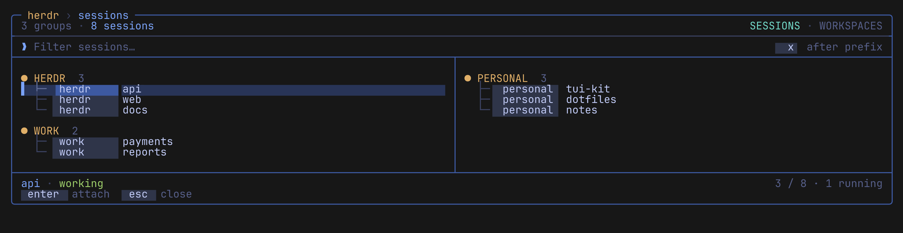

Rules of the anatomy:

- **The title lives in the top border**, never as a row. It is
  `gold bold name` + `guide › ` + `accent bold surface`, so the product is gold
  and the surface is blue at a fixed location on every screen.
- **One cell of padding** between a border and its content, on every row. Content
  never touches the frame.
- **The rule under the header has no joints** (├──┤). The columns have not opened
  yet, so a joint would announce a column that does not exist.
- **The column rules carry joints** (┬ above, ┴ below), so the vertical rules grow
  out of the frame. A column rule painted flat leaves the verticals floating.
- **One blank row** separates the opening column rule from the first group
  header, and one blank row separates two groups. Never two.
- **The footer is two lines, never three**: the detail line (what is selected) and
  the hint bar (what the keys do). A status message rides the detail line at the
  right edge; it never adds a row.

## 3. Chips

A chip is a **padded slab**, not a bracketed word:

```
[x]      ✗   brackets read as literal text
 x       ✗   a key with no surface is just a word
 x       ✓    bold label, one cell of padding each side, on #2f3549
```

The chips, captured at 80x19:

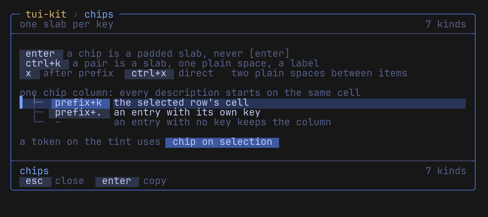

Rules:

- The background carries the padding: `slab.Render(" " + label + " ")`.
- A label follows its chip after **exactly one plain space**.
- Chips that share a column share a **chip width** (`chip.Cell`), so every
  description starts on the same cell. The column is capped (14 cells) and never
  eats the description's minimum room.
- An entry with **no key of its own** keeps the column with a dim `–` and no slab
  (`chip.UnsetCell`). A group of such entries must not read as a wall of empty
  boxes — and must never claim a key it does not have (`enter` is not "the key"
  of a discovered action).
- Hints are chips too (`chip.HintBar`): the key is a slab, the label is muted
  prose, items are separated by **two plain spaces**, and a hint is **never** cut
  into a second line.
- **The hint bar pages; it never hides a hint.** When the hints do not fit, the
  bar shows the whole hints the width holds, in declaration order (the order *is*
  the priority), and ends with the **paging chip**: the `tab` slab, then the
  muted position `more 1/2` — current page, then page count. The paging chip is
  **part of the width budget**, so no line ever exceeds the frame.
- The paging key is `chip.PageKey` (`tab`) and it is **non-printable**, so it
  never collides with the filter the screen's key bar reads. `tab` moves to the
  next page and **wraps** from the last page back to the first. The kit renders
  the key; each product wires the handler.
- When everything fits, the bar is one line with **no paging chip** and the key
  does nothing. The bar never wraps and never scrolls mid-hint: the only thing
  ever cut is one hint wider than the whole bar, and that cut ends with `…`.
- **The bar resets itself.** A hint bar recognises the set it drew, so a screen
  whose hints change (a confirmation gains its gold `y`) starts again on page 0
  without carrying a reset of its own; `HintBar.Page` still names a page when a
  product wants one.
- **The reset happens when the bar draws**, not when the hint set is built: the
  first render of a different set is the one that starts it on page 0, so a model
  renders the bar once per update. Rendering twice in one update, with two
  different sets, is a model bug the bar cannot see.
- **One hint may carry its own slab** (`Hint.Slab`), so the gold `y` of a
  confirmation keeps its meaning while its neighbours keep the default.
- **A chip may carry the accent instead of prose** (`list.Roles.ChipAccent`): a
  keybinding guide's binding is a token on the same slab, with the accent label.
  The role follows the row's surface, so no product overwrites `Roles.Chip` to
  paint one column differently.

Page 1 and page 2 of the same bar at 60 cells:

| Page 1 | Page 2 |
| --- | --- |
| 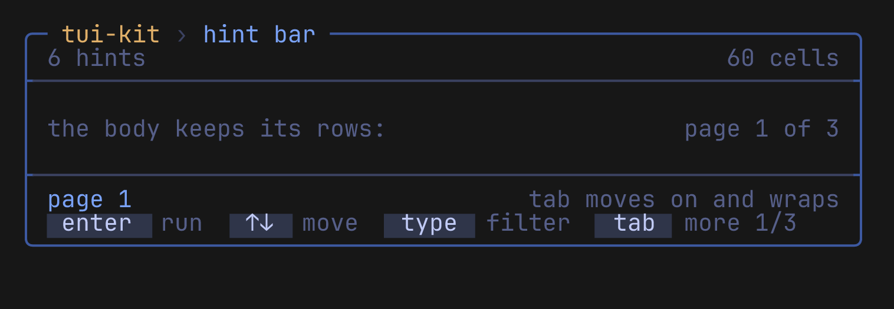 | 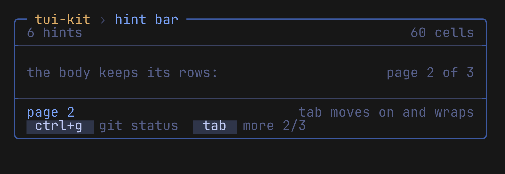 |

## 4. Selection

The selection is a **tint**, not a painted bar:

```
▌ ├─  prefix+k  Command bar            ← #283457 behind the row, ▌ in cell 0
  ├─  prefix+p  Plugin manager         ← panel surface
```

- The row gains the background `#283457`; **every element keeps its own role**.
  The name becomes `text` bold on the tint, secondary facts become
  `muted on selection`, the tree guide becomes `guide on selection`.
- Green, gold, teal and red keep their meaning on the tint (`OnSelection`): a gold
  default marker stays gold, a green live dot stays green.
- The **accent `▌` occupies the row's first cell**, replacing the indent. Every
  other cell keeps its x, so the columns do not shift when the cursor moves.
- The tint runs to the row's full width. A tint that stops mid-row reads as a
  broken highlight.
- A chip on the selected row uses `chip on selection`, one step brighter, so the
  token still reads as a token on the darker background. A chip that carries the
  product's accent (`Roles.ChipAccent`, §3) steps the same way and keeps the accent
  label: the accent is the chip's meaning, not its surface.
- **Exactly one row** carries the tint on a screen.
- **The row under the pointer wears a fainter tint** (`theme.HoverBG`), never the
  selection's: it is a preview of what a click would select. Selection wins over
  hover, and a hovered row carries no `▌`: a cursor mark belongs to the selection.
  A **fact glyph stays**: the gold `◆` of the default item, a green live `●` and a
  red failed `○` say what the row *is*, not where the cursor is, so hovering never
  changes them (§11).

Selection and hover, captured at 80x14 — the selected row first, the hovered row
directly under it:

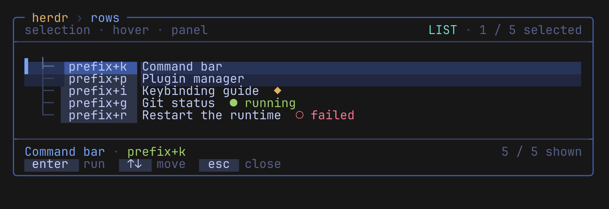
- The gold `◆` is for state that outlives the selection (the default item); it is
  quieter than the selection and is not a second cursor. It **follows the row's
  facts** (`list.Mark`), after two cells of the row's own background, never before
  the chip column: a marked row must not move the columns its neighbours use.

### Nested rows

A row that is the detail of the row above it — a session's workspaces — hangs under
that row's guide instead of starting on its own indent:

```
  ├─  Command bar    herdr · 3 tabs        ◆
  │ ├─  web          3 tabs · 2 panes      ● working
  │ └─  docs         1 tab · 1 pane
  └─  Agent bench    herdr · 1 tab
    └─  work         1 tab · 2 panes
```

- `list.Entry.Parent` (`*list.Parent{Last: …}`) makes the entry a nested row: it
  draws the parent's continuation column — the cells the parent spent before its
  body — and then its own guide, so **a child starts five cells past its parent**
  and its guide lands on the cell its parent's guide closed on.
- The continuation column **keeps the parent's guide open** (`│`) while the parent
  has a sibling below it, and stays **blank** when the parent closes the group, so
  a branch is never drawn to nowhere. The child's own guide follows the same rule
  as any row's: `├─`, or `└─` when it is last.
- The continuation column is the **row's own background** (`Roles.Space`, `Roles.Guide`),
  so a tinted nested row is one band from the first cell of the continuation to the
  row's edge, and the guide keeps its role on the tint.
- A nested row is a row like any other: `list.Entry` **records its own zone** — the
  whole row, continuation column included, so a click on the guide acts on the row.
  What a click *means* stays the product's decision; a screen that treats children
  as facts of the parent (herdr-suite's switcher: a click on a workspace selects its
  session) passes the parent's id and the panel roles.

The same list at 88x16 — the first session keeps its guide open under itself, the
last one closes it, and the hovered and the selected child show the tint running
through the continuation column:

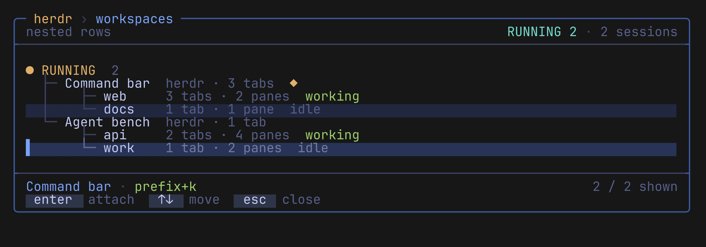

## 5. Rhythm and spacing

- **One blank row between groups.** Two blank rows read as "something is missing
  here"; none reads as one long list.
- **One blank row above the first group**, under the opening column rule.
- Gaps between columns belong to the row's own background: on a selected row they
  are tinted (`Roles.Gap`), never plain spaces.
- Separators are ` · ` in the guide role: one space on each side, never two, and
  never touching a chip's background.
- The right side of a line is where short, stable facts live (counts, page,
  summary). When a line must give something up, the **left** side is clipped
  first; the summary stays flush with the inner edge.
- Nothing ends a line with trailing spaces outside the frame's padding, and no
  row repeats a space before a separator.

### A table's last column

A row that ends in a short, stable fact — a table's source, a count, a mode — closes
with that fact in a column flush against the row's edge, never stuffed into the
description with hand-padded spaces:

```
│   ├─  prefix+k  Command bar                                            herdr-suite  │
│   ├─  prefix+p  Plugin manager                                         herdr-suite  │
│   ├─  ctrl+g    Lazygit                                                custom       │
```

- `list.Entry.Trailing` owns the column: it sits on the row's last cells, and the
  description is clipped first, with `…`, when the two do not fit.
- `list.TrailingGap` (two cells) is the least the two columns keep between them,
  and every cell of it is the row's own background (`Roles.Gap`), so the selection
  and the hover tint run unbroken up to the trailing column.
- **The spare room and that gutter are one run of the row's background**, never two:
  the row writes the same bytes a hand-aligned column writes (`Roles.AlignRight`),
  so moving a column into `Entry.Trailing` changes nothing it renders, and no
  rasterizer seam shows inside the gutter.
- **A table reserves the column width** (`Entry.TrailingWidth`): the column ends on
  the row's edge and its text is left-aligned inside it, so every row's value starts
  on the same cell — the cell the table's header names. The cells a value leaves
  empty are the row's own background, so the tint reaches the row's edge instead of
  stopping inside the last word. Reserve one cell of air after the longest value.
- A table's header names the cells its values land on; `list.Entry` spends five
  cells of indent and tree guide before its body.
- **Never pad the right side of the description by hand.** The gutter is the row's:
  a painted gutter breaks the tint before the last column and drifts on a narrow
  pane.

The table at 88x14 — the selected and the hovered row above the panel rows, the
accent chip on every row, the source column on one cell and flush with the edge:

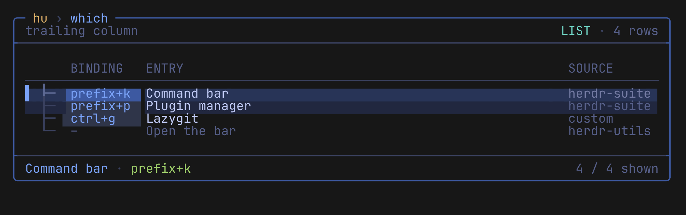

## 6. Typography

One glyph, one meaning, one cell wide — so a glyph never shifts a column.

| Glyph | Meaning | Role |
| --- | --- | --- |
| `…` | an honest cut | current |
| `–` | no key / no value | muted |
| `·` | separator between two facts | guide |
| `›` | the product → surface cut in a title | guide |
| `●` | live (also the group glyph) | green / gold |
| `○` | idle | muted |
| `◆` | state that outlives the selection | gold |
| `▌` | the selected row's edge | accent on tint |
| `▏` | the live filter cursor | accent |
| `❱` | the filter marker | accent |
| `├─` `└─` | tree guide, middle / last of a group | guide |
| `│` | the continuation column of a nested row: the parent's guide kept open | guide |
| `▖▘▝▗` | work in progress | teal |

Tree guides **close** a group: the last entry of a group is `└─`, the others
`├─`. A list that trails off with `├─` looks unfinished.

## 7. Responsive rules

The frame owns its width. Whatever the terminal does, no line wraps and no line
exceeds the frame.

| Width | Columns | What is dropped first |
| --- | --- | --- |
| 180 | 3 when the surface holds three groups | nothing; the header may carry the page |
| 140 | 2 | a fourth column is never invented |
| 80 | 1 | the legend, then the hint bar pages behind `tab`; the first hint always survives |

- Column count follows the inner width (`frame.ColumnCount`): 3 from 148 inner
  cells, 2 from 98, 1 below — and never more than the surface has groups.
- Columns split the inner width evenly, one cell of rule between them
  (`frame.ColumnWidths` + `frame.ColumnRule`), so a rule — never a guess —
  decides where a column starts.
- A body shorter than its content **pages** rather than squeezing: the header
  names the page (`page 1 / 3`), and the selection decides which page is shown.
- A body the pane cannot hold at all is **cut below `BodyRows`, never squeezed**,
  and a group header is never left with no entry under it.

Three columns, captured at 160x13: the column rules grow out of the frame, the
vertical rules run unbroken through the padding and spare rows, and each column
keeps its own chip width.

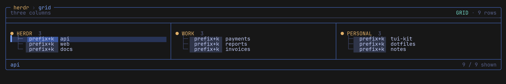
- A hint, a fact or a chip is dropped **whole**. The only thing that is ever cut
  is a single string, and a cut ends with `…`. A hint is never dropped at all:
  the hint bar pages instead.

## 8. Size and anchoring

A frame is not the height of its content. It is the height of its pane, bounded,
and it pins its footer to its own bottom edge.

```
pane, 50 rows tall                 frame, 40 rows tall (MaxHeight)

  (centred: 5 blank rows)          header
                                   rule
        ╭────────────────╮         filter + legend
        │ header         │         column rule
        │                │         ── one blank row ──
        │ body           │         body
        │                │         body, spare room below it
        │                │         ── one blank row ──
        │ footer         │         column rule
        ╰────────────────╯         detail line
  (centred: 5 blank rows)          hint bar
```

Rules:

- **Size is a range, not a wish** (`frame.Size`: MinWidth, MaxWidth, MinHeight,
  MaxHeight). The frame's width and height are the pane clamped to that range. A
  pane smaller than the minimum wins: a frame never exceeds the pane showing it,
  because overflowing is worse than cramped.
- **The height is the clamped height, never the content's height.** A screen with
  three rows and a screen with three hundred are drawn the same height, so the
  footer never floats mid-pane.
- **The footer is pinned.** The header sits under the top border, the footer
  occupies the last inner rows, and the body takes what is between them. Spare
  room lands inside the body, below its content, and never below the footer.
- **The body always keeps one blank row at its top and one at its bottom**, even
  when it pages or scrolls: the content must not touch the rule above it or the
  footer below it, or two sections stop being distinguishable. The body's usable
  rows are the clamped height minus the borders, the header rows, the footer rows
  and those two padding rows; `frame.Surface.BodyRows` answers the count, and a
  product pages or scrolls its content against it. A header that must name the
  page asks `BodyRowsFor(paneHeight, headerRows, footerRows)` **before** it
  composes those rows, so the count costs no placeholder row.
- **A frame smaller than its pane is centred** (`frame.Surface.Popup`): blank rows
  above and below it, never one large gap under the footer.
- **In a column grid the padding and spare rows are grid rows too**
  (`frame.Surface.Columns`, `frame.BlankRow`): the column rule runs continuously
  from the opening `┬` joint to the closing `┴` one. A plain blank row under a
  joint leaves a lone tick, a gap, the rule resuming on the content, and another
  tick above the closing joint.
- **The bounds are `frame.Recommended`: 60 to 160 wide, 16 to 40 tall.** 60 is
  the narrowest width that still shows the first page of the hint bar, a chip
  column and a description; 160 is as far as one footer can be read across; 16 is
  the borders, header, filter, rules, two footer rows and a three-row body; 40 is
  a whole screen of groups, past which the footer drifts away from its content.
- **A product's herdr popup manifest should offer that range.** A popup smaller
  than the minimum gives the frame no room for a body; a popup larger than the
  maximum leaves pane the frame does not use. Aim the manifest percentage at the
  middle of the range (74% x 62% of a 190x60 terminal is about 140x37) and let the
  clamp and the centring absorb the rest.

## 9. States

Every surface must have an answer for three states, and none of them is a blank
box.

**Empty** — nothing to list yet. One centred line naming the state, one dim line
naming the next step, one blank row above and below:

```
│                                                                  │
│                      Nothing here yet                            │
│                  press enter to create one                       │
│                                                                  │
```

**Zero match** — a filter that matches nothing. Name the query, offer the way
out, and never draw empty groups:

```
│                                                                  │
│            No binding matches “nothing-matches-this”             │
│                                                                  │
│     ctrl+u clears the filter · esc closes the guide              │
│                                                                  │
```

**Loading** — work in flight. A teal spinner (`spinner.Render`) on the line that
describes the work; the caller owns the tick, so the screen costs nothing while
nothing is happening. Never a full-screen "loading" placeholder.

| Empty | Zero match | Loading |
| --- | --- | --- |
| 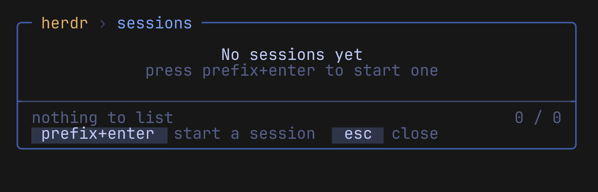 | 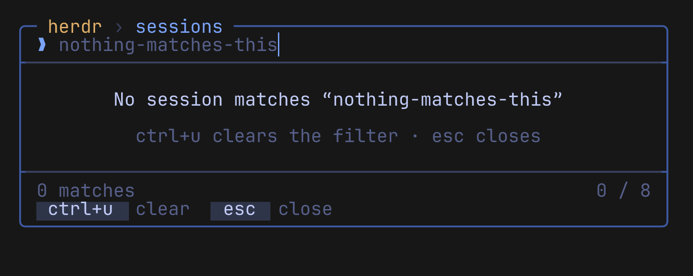 | 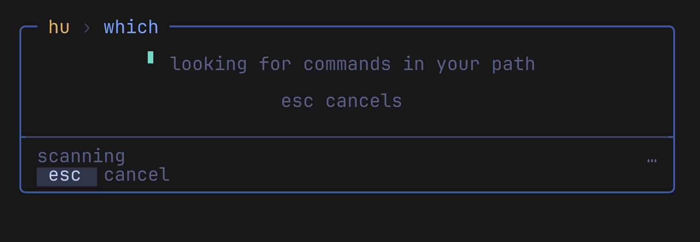 |

## 10. Anti-patterns we fixed

These are real regressions from the two products. Do not bring them back.

| Anti-pattern | Why it failed | The rule now |
| --- | --- | --- |
| Solid selection bar (`bg` over the whole row, one foreground) | Every colour on the row died; state stopped meaning anything. | A tint; each element keeps its role. |
| Selection without the `▌` edge | The eye could not find where the row starts. | The accent edge in cell 0. |
| Selection that painted the tree guide flat | The guide disappeared and the row looked unparented. | `guide on selection` lifts it instead. |
| Chip slab in the panel colour on the tint | The token sank into the selection. | `chip on selection`, one step brighter. |
| Bracketed chips (`[enter]`) | Reads as literal text, not as a token. | Padded slab, no brackets. |
| Chip label glued to the slab (`enterrun`) | No separation between token and meaning. | Exactly one plain space, then the label. |
| Caret key names (`^K`) | Not what the key is called, not searchable. | `ctrl+k`. |
| Separators painted with a chip background (` · ` inside the slab) | The gutter became a second chip. | Two plain spaces between items. |
| Rules without joints (floating rules) | The columns looked disconnected from the frame. | `┬` / `┴` joints. |
| A rule before the columns opened carrying joints | Announced a column that did not exist. | Plain `├──┤` under the header. |
| Multiple blank rows between groups | Read as missing content. | Exactly one. |
| Selected row's indent leaked as plain spaces | The tint had a gap at the left edge. | The row's own background in every gap. |
| Strings rendered once at init | Kept the Ascii profile the process started with and lost colour forever. | Render at call time, always. |
| Left side shrinking the summary on a narrow window | The count jumped around while the user filtered. | Clip the left side first; the summary stays flush. |
| Wrapping a hint bar to a second line | The frame grew a row and pushed the footer. | Page whole hints behind the paging chip. |
| Hints hidden without an indicator | A narrow window silently lost keys the user needed, and nothing said more existed. | Page them: the last cell group is the paging chip, `tab` `more 1/2`. |
| A frame that hugs its content and leaves the pane empty below the footer | The footer sat mid-pane, away from the edge the eye looks for, and the surface read as a half-drawn popup. | The height is the clamped pane height; the footer is pinned to the bottom edge. |
| A body with no bottom padding | Content touched the rule and the section above read as cut off. | One blank row at the top of the body and one at the bottom, always. |
| Body padding rows drawn without the column separators | The column rule broke into a lone tick under `┬`, a gap, the rule resuming on the content, and another tick above `┴`. | Blank body rows are grid rows: same widths, same separators. |
| Empty groups drawn under a zero-match filter | The screen looked broken rather than empty. | One calm message and the way out. |
| Loose text as a click target | Every word became a maybe-link, and the screen stopped saying what was actionable. | Only a chip and a row are clickable; the kit records zones for nothing else. |
| A destructive action on a single click | One slipped press deleted the thing the user was reading. | A click selects; enter or a double click runs, and a destructive action asks first. |
| A mouse-only feature | A keyboard user lost an action that had no key. | Every click maps to a key: mouse-only is a bug. |
| A hover as strong as the selection | The pointer competed with the cursor and the row the user chose disappeared. | A fainter tint, selection wins, no accent edge, no gold mark. |
| Hand-rolled text selection in a screen that captures the mouse | A second, worse editor: no word boundaries, no scrollback, its own clipboard. | Let the terminal keep the drag; copy one value with one OSC 52 key. |
| A hand-padded space before a table's last column | The gutter belonged to the caller: the tint broke before the column and a narrow row moved it. | `list.Entry.Trailing` owns the gutter (`TrailingGap`), tinted like the rest of the row. |
| A table whose values start on different cells | A right-aligned last column reads as a column of numbers, not as one column; the eye cannot scan it and its header names no cell. | Reserve the column (`Entry.TrailingWidth`): every value starts on the header's cell, and the tint reaches the row's edge. |
| A hovered row that loses a fact glyph | The default marker vanished under the pointer, so hovering looked like it changed what the row was. | Only the cursor mark (`▌`) is the selection's; the gold `◆` and the state glyphs stay. |
| Overwriting `Roles.Chip` to paint one column | A second chip surface per screen, and the override had to remember the selection variant itself. | `Roles.ChipAccent` carries the accent on the panel, the hover and the selection. |
| A hint bar rendered twice in one update | The second render saw a different set and sent it back to page 0, so the page the key chose never stuck. | The reset happens when the bar draws: render once per update. |
| A theme installed in the middle of a render | Half the frame painted with one palette, half with another. | Install at start-up, or when late terminal colours arrive — never mid-render (§15). |
| A role guessed from the ANSI-16 palette | A semantic colour became whatever the terminal's slot happened to be, with no tint and no contrast behind it. | `theme.System` derives from one `query.Palette` with the contrast gates; never guess (§15). |

## 11. Mouse

The mouse is a second way to reach the same actions, never a second interface: a
screen that only works with a pointer is broken.

Rules:

- **Only a chip and a row are clickable.** Loose text, a rule, a header, a title
  and a border are not targets, and the kit records no zone for them, so a
  product cannot wire one by accident.
- **The kit records where it drew them, the product acts.** `zone.Map` collects
  each element's rectangle in the frame-content coordinates the surface names
  (`frame.Surface.BodyY`, `BottomY`, `ColumnX`; `list.Entry` and
  `chip.HintBar.RenderZones` register themselves), and `RenderZones` /
  `PopupZones` translate the map into the pane's own cells — centring, border,
  header rows, body padding and column offsets included — dropping anything the
  surface did not draw. The product asks `Hit(x, y)` and gets an id.
- **A click selects; it never runs.** Selecting is reversible and is what a
  pointer is good at. **Enter or a double click runs** the selection.
- **A destructive action never fires on one click.** Killing a session, deleting
  a workspace or overwriting a file has no single-click path: it asks, and its
  confirmation keeps a keyboard answer.
- **The wheel moves the body**: it scrolls the list, or moves the selection when
  the whole list is already visible. `frame.Surface.BodyRows` is the row count
  both the drawing and the scrolling use.
- **Hover is a preview of the selection** in a fainter tint (§4). Selection wins
  over hover, and a hovered row carries no `▌`. A fact glyph — the gold `◆`, a
  live `●`, a failed `○` — stays on a hovered row: it describes the row, not the
  cursor.
- **Keyboard parity, always.** A click is the cursor keys, a run is `enter`, and a
  click on the paging chip is `chip.PageKey`. The hint bar says so.
- **Shift+drag still belongs to the terminal.** A program that captures the mouse
  can leave the drag to it, but whether plain shift+drag selection and OSC 52
  pass-through work inside herdr is a product-side check; it is not verified in
  this repository.

The kit has no Bubbletea dependency, on purpose: a consumer of `theme`, `frame`
and `chip` should not inherit an event loop, and the kit does not own the tick,
the keymap or the model. The translation is ten lines in the product's update
loop:

```go
func (m model) Update(msg tea.Msg) (tea.Model, tea.Cmd) {
	if click, ok := msg.(tea.MouseMsg); ok {
		if id, hit := m.zones.Hit(click.X, click.Y); hit {
			switch {
			case id == chip.PageZone: // a click on the paging chip is tab
				m.bar.Next(m.width, m.hints()...)
			case strings.HasPrefix(id, "row:"):
				m.cursor = rowIndex(id) // a click selects; enter runs
			}
		}
	}
	...
}
```

A product that does not want the mouse passes `nil` for the map and every kit
helper records nothing.

## 12. Copying a value

- **A TUI that captures the mouse does not reimplement text selection.** The
  terminal handed the drag to the program, so a hand-rolled selection is a
  second, worse editor: no word boundaries, no scrollback, and a clipboard of its
  own. gentle-shell implements one because copying a chat transcript is what that
  program is for; every other screen lets the terminal keep the drag.
- **When a product needs one specific value copied**, it offers exactly one key
  for that value and writes it with OSC 52 (`clipboard.OSC52`). The value is the
  thing the cursor is on — the selected session's socket, the command, the path —
  never a region, and a hint names the key (`chip.Hint{Key: "y", Label: "copy
  path"}`).
- **A gold slab keeps the confirmation readable**: `chip.Hint{Key: "y", Label:
  "copy", Slab: &theme.ChipGold}`.
- **OSC 52 is a request, not a guarantee.** The terminal may ignore it, cap the
  payload at a few kilobytes or hand it to a clipboard tool. Keep the copied value
  short, and say what was copied on the detail line.
- Inside herdr, plain shift+drag selection and OSC 52 pass-through are
  product-side checks and are **unverified** here.

## 13. Gallery

`docs/gallery/` holds every state above, captured from the real code. One command
regenerates the whole gallery:

```sh
go run ./examples/gallery            # writes docs/gallery/*.png
go run ./examples/gallery -only rows # one state, while working on it
```

It renders each state at a fixed size with the truecolor profile, hands the ANSI
to `freeze` (`--font.size 10 --theme tokyonight`, no window chrome, no shadow) and
re-encodes the PNG as a palette, so an image only changes when the look changes
and the whole gallery stays under half a megabyte. The three demo captures are
produced by running `examples/demo` itself, never by a copy of it.

Two rules keep the images honest:

- **A capture is the smallest frame that shows its state with the standard
  padding.** The guide must not show the empty body §8 warns about, so the
  non-demo states are drawn without the size range (the pane *is* the frame) and
  their heights are the borders, the edges, the content and the two padding rows.
  A product still draws within `frame.Recommended`.
- **The palette in an image is the palette in §1.** The rasterizer rounds a channel
  by a step now and then, so a colour that close to a role is snapped back to the
  role (`theme.Palette`) before the palette is built: a captured slab is
  `#2f3549`, not `#2f3449`.

| Image | Shows |
| --- | --- |
| [frame-anatomy.png](docs/gallery/frame-anatomy.png) | §2, the whole surface at 140x19 |
| [columns.png](docs/gallery/columns.png) | §7, a three-column body at 160x13 |
| [chips.png](docs/gallery/chips.png) | §3, the token surface at 80x19 |
| [rows.png](docs/gallery/rows.png) | §4 and §11, selection and hover side by side at 80x14 |
| [table.png](docs/gallery/table.png) | §5, a row's trailing column at 88x14 |
| [nested.png](docs/gallery/nested.png) | §4, rows nested under a parent's guide at 88x16 |
| [hints-page-1.png](docs/gallery/hints-page-1.png), [hints-page-2.png](docs/gallery/hints-page-2.png) | §3, the paged hint bar at 60x10 |
| [empty.png](docs/gallery/empty.png), [zero-match.png](docs/gallery/zero-match.png), [loading.png](docs/gallery/loading.png) | §9, the three states |
| [demo-180x50.png](docs/gallery/demo-180x50.png), [demo-140x40.png](docs/gallery/demo-140x40.png), [demo-80x24.png](docs/gallery/demo-80x24.png) | the demo at its three captured sizes |

The demo at 140x40:

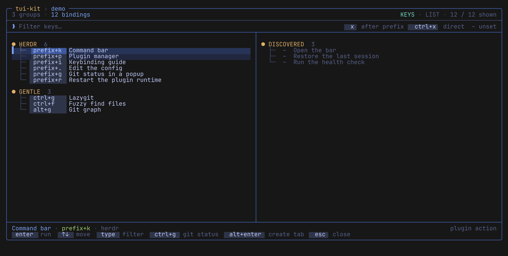

The same demo at 80x24, where the hint bar pages behind `tab` and the body stops
at `BodyRows`:

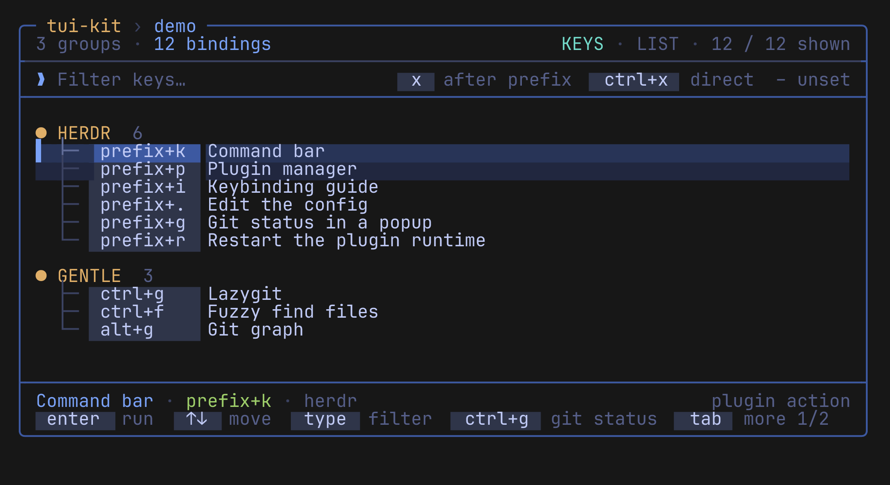

## 14. Migration map

The private copies these packages were extracted from, for the screens that are
still on them:

| Old (herdr-suite `internal/ui`) | New |
| --- | --- |
| `ui.Frame`, `ui.Layout`, `ui.Float`, `ui.Footer` | `frame.` |
| `ui.Section`, `ui.Guide`, `ui.Row`, `ui.SelectedRow`, `ui.Roles`, `ui.RowRoles` | `list.` |
| `ui.Chip`, `ui.Hint`, `ui.Hints` | `chip.` (`Chip`, `Hint`, `HintBar`; `Hints` is page 0) |
| `ui.Width`, `ui.Clip`, `ui.ClipLeft`, `ui.EllipsisPath`, `ui.Fit`, `ui.Join`, `ui.Center`, `ui.ShortPath`, `ui.RelativeTime`, `ui.Plain` | `text.` |
| `ui.Live`, `ui.Idle`, `ui.Mark`, `ui.SelectMark`, `ui.Cursor`, `ui.Ellipsis` | `text.` |
| `ui.Dot`, `ui.Label` | `theme.` |
| `ui.StateGlyph`, `ui.StateWord` | `list.` |
| `ui.Text` … `ui.ChipRed`, `ui.OnSelection` | `theme.` |
| `ui.Spinner`, `ui.SpinnerFrames` | `spinner.Render`, `spinner.Frames` |

v0.4.0 renames nothing; it adds the pieces both products were working around:

| Workaround | New |
| --- | --- |
| `zone.Map.Add(id, 0, surface.BodyY(line), w, 1)` beside a hand-composed `list.Row` | `list.Entry` with an empty `Cell`: it draws the same row and records it. |
| The trailing column built into `Description` with `roles.Space.Render("  ")` and `text.PadLeft` | `list.Entry.Trailing` + `list.TrailingGap`. |
| `roles.Chip = theme.ChipAccent` on every row that is not selected | `list.Roles.ChipAccent` (and `theme.ChipAccentOnSelection` on the tint). |
| `text.JoinDropRight(left, " "+right, width)` to buy a gutter | `text.JoinDropRight(left, right, width)`. |
| A placeholder header row replaced after `BodyRows` becomes answerable | `frame.Surface.BodyRowsFor(paneHeight, headerRows, footerRows)`. |

v0.4.1 moves the last two hand-placed row pieces into the kit:

| Workaround | New |
| --- | --- |
| A nested row composed by hand (`continuation + list.Guide(...) + " "`) with its click target added beside it (`zones.Add(childID, 0, y, width, 1)`) | `list.Entry.Parent`: the entry draws the parent's continuation column, its own guide, and records its own zone. |
| The trailing column aligned by hand — `roles.AlignRight(content, roles.Muted.Render(when)+roles.Gap(1), inner-text.Width(list.Row(roles, last, "")))` | `list.Entry.Trailing` with `TrailingWidth: text.Width(when)+1`: the same bytes, one span of the row's background in the gutter. |

A v0.4.0 caller's rows are unchanged except for one invisible detail: two adjacent
spans of the same tint are now one, so a tinted trailing row's ANSI carries one
background run instead of two. Every cell, every glyph and every role is identical.

| Old (herdr-utils `internal/which`) | New |
| --- | --- |
| `truncate`, `padPlain`, `padStyled`, `fitStyled` | `text.Clip`, `text.Fit` |
| `padLeft` | `text.PadLeft` |
| `joinSides` | `text.Join` / `frame.Footer` |
| `topBorder`, `bottomBorder`, `panelLine` | `frame.Frame.Top`, `.Bottom`, `.Row` |
| `plainRule` | `frame.Frame.Rule` |
| `columnRule`, `columnWidths`, `columnCount`, `assemble` | `frame.ColumnRule`, `frame.ColumnWidths`, `frame.ColumnCount`, `frame.Grid` |
| `chipPair`, `chipCell`, `hintsLine`, legend items | `chip.Pair`, `chip.Cell`/`chip.UnsetCell`, `chip.Hints`, `chip.Legend` |
| `styleSelectEdge` / `styleSelectChip` / `styleSelectText` / `styleSelectMuted` | `theme.SelectionEdge`, `theme.ChipOnSelection`, `theme.TextOnSelection`, `theme.MutedOnSelection` |
| `roleText` … `roleChipBG`, `styleText` … `styleSelectMuted` | `theme.ColorText` … `theme.ChipRed` |

## 15. Themes

The palette §1 documents is the built-in theme, `theme.TokyoNight()`, and the
only theme the kit renders with until a program installs another one. A theme
is one resolution of the fifteen roles; each role is a `#rgb`/`#rrggbb` hex, a
256-colour index written as a decimal string, or the empty string — the empty
role is the terminal's own default, and renders no colour escape at all.

- **`theme.Use(them)`** installs a theme: every role style in the kit is
  rebuilt, and every surface that captured roles at init (the list's three
  role sets) rebuilds with them through the hook `theme.OnUse` registers. A
  theme whose roles are none of the three shapes is rejected, and the previous
  theme stays in force. Install at start-up, or again when the terminal's
  colours arrive late — never in the middle of a render.
- **`theme.Active()`** is the theme in force; **`theme.TokyoNight()`** is the
  built-in, the fallback every failure path ends in.
- **`theme.System(palette)`** generates a theme from what the terminal
  reported about itself — one `query.Palette` from `query.Colors()`. The
  semantic colours come from the ANSI slots (the brighter of each pair: blue
  is the accent, yellow is gold, cyan is teal, green is green, red is red);
  the text is the terminal's foreground once it clears the 4.5:1 contrast
  gate against its own background; and every surface role — muted, guide,
  border, chip, selection, hover and their on-tint lifts — is a mix of the
  background toward the text or the accent, in the same proportions the
  built-in palette sits at. A Tokyo Night terminal generating its own theme
  lands within twenty channel steps of the §1 table, which the golden test
  pins; the teal it wears is the terminal's own cyan, not `#73daca`. A half
  answer is never guessed at: an unusable palette is the built-in theme.
- **`theme.LoadFile(path)`** (and `theme.LoadJSON`) read a custom theme from
  a JSON file — a partial override over the built-in, naming only the roles
  it changes, each a hex, an index (quoted or not) or empty. A role name the
  palette does not have is an error, so a typo is caught instead of silently
  ignored:

  ```json
  {
    "name": "gruvbox",
    "colors": { "text": "#ebdbb2", "accent": 196, "chip": "" }
  }
  ```

- **`theme.Auto(setting, dir)`** is the whole policy in one call: a named
  setting loads `<dir>/<setting>.json` from the directory the product keeps
  its themes in, an empty setting asks the terminal and generates the system
  theme, and every failure along the way — a missing file, a broken one, a
  terminal that cannot be asked — is the built-in Tokyo Night palette. A
  program with no theme setting and no tty renders exactly what it rendered
  before this section existed.

`query.Colors()` is the kit's only I/O. One batched query — the default
foreground, the default background, the sixteen slots — written to `/dev/tty`
in raw mode, the replies read until the DA1 reply closes the batch or the
100 ms timeout expires, and the palette adopted all-or-nothing: a terminal
that answers only part of the batch yields no palette, so the caller falls
back to the built-in theme. Output that is not a terminal is never written
to: `Colors` returns `ErrNotTTY` without writing a byte.
