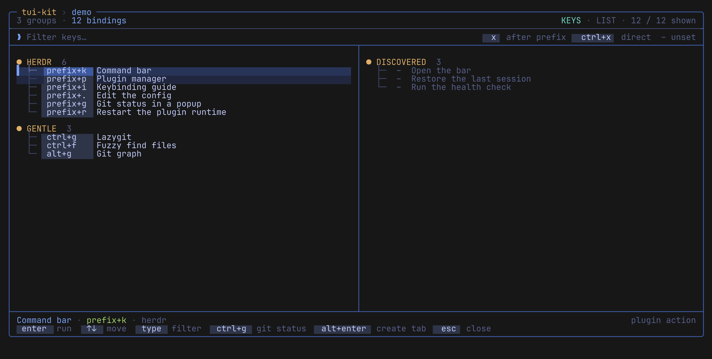

# tui-kit

The shared visual system of my terminal UIs, extracted from the code that already
ships in [herdr-suite](https://github.com/WilberC/herdr-suite) and
[herdr-utils](https://github.com/WilberC/herdr-utils): one Tokyo Night palette,
one frame, one chip, one selection, one footer.

The point is that two binaries read as one product instead of two screens that
happen to share a terminal. Render code names a **role**, never a colour, and the
frame clips every line to its own width, so a view can never wrap — at 180
columns or at 80.

`DESIGN.md` is the canonical visual guide both products follow; this package is
its executable form.

## Install

```sh
go get github.com/WilberC/tui-kit@latest
```

Requires Go 1.27.3 or newer.

## Usage

```go
package main

import (
	"fmt"

	"github.com/WilberC/tui-kit/chip"
	"github.com/WilberC/tui-kit/frame"
	"github.com/WilberC/tui-kit/list"
	"github.com/WilberC/tui-kit/theme"
)

func main() {
	f := frame.Frame{
		Title: theme.GoldBold.Render("my-tui") + theme.Quiet.Render(" › ") + theme.AccentBold.Render("list"),
		Width: 60,
	}
	roles := list.RowRoles(true) // the highlighted row
	cell := chip.Cell(roles.Chip, "ctrl+k", 8)
	row := list.ChipRow(roles, true, cell, roles.Name.Render("Open the command bar"), f.ContentWidth())

	// The bar keeps its own page; tab (chip.PageKey) advances it and wraps.
	var bar chip.HintBar
	hints := bar.Render(f.ContentWidth(),
		chip.Hint{Key: "enter", Label: "run"},
		chip.Hint{Key: "esc", Label: "close"},
	)

	fmt.Print(frame.Layout(f,
		f.Row(theme.Muted.Render("3 bindings")),
		f.Rule(),
		f.Row(list.Section("keys", 3)),
		f.Row(row),
		f.Row(frame.Footer(theme.AccentBold.Render("Command bar"), "3 / 3 shown", f.ContentWidth())),
		f.Row(hints),
	))
}
```

Hint bars page instead of hiding what does not fit: `HintBar.Render` draws one
page, `HintBar.Pages` says how many there are, and `HintBar.Next` moves forward
and wraps. In the key handler, `case chip.PageKey:` calls `bar.Next(width, hints...)`
and returns — the kit renders the key, the product wires it. `chip.Hints` still
works and is exactly page 0.

### Mouse

The kit records where it drew each clickable element, so a product never measures
its own layout: rows and chips register themselves, and the surface translates the
map into the pane's cells (centring, borders, padding and columns included).

```go
zones := zone.New()
// Every Entry that carries a row id registers its row and its chip slab.
row := list.Entry{Roles: roles, Cell: cell, Description: "Open the command bar",
    Width: f.ContentWidth(), ID: "row:0", ChipID: "chip:0", Zones: zones,
    X: surface.ColumnX()[0], Y: surface.BodyY(line)}
// The hint bar records each chip and the paging chip.
barText := bar.RenderZones(zones, 0, surface.BottomY(paneHeight, 2), f.ContentWidth(), hints...)
view := surface.PopupZones(paneWidth, paneHeight, body, zones)

id, hit := zones.Hit(clickX, clickY) // "row:0", "chip:0" or chip.PageZone
```

An entry with no chip column leaves `Cell` empty: it draws exactly the row
`list.Row` draws and still records its row zone, so a session row needs no
hand-measured click target beside the kit's. A table's last column is
`Entry.Trailing`, which closes on the row's edge with `list.TrailingGap` cells of
the row's own background before it, so the tint runs through the gutter. A table
also reserves the column (`TrailingWidth`): every value then starts on the same
cell — the one its header names — and the cells a value leaves empty stay the row's
own background, so the tint reaches the edge:

```go
row := list.Entry{Roles: roles, Last: false, Cell: cell,
    Description:   roles.Name.Render("Command bar"),
    Trailing:      roles.Muted.Render("herdr-suite"),
    TrailingWidth: 12, // reserved: left-aligned on this cell, column flush right
    Width:         content}
```

With `TrailingWidth` zero the column is as wide as its text and right-aligned
against the row's edge, the v0.3.0 behaviour.

A row that is the detail of the row above it sets `Parent`, and the entry draws the
parent's continuation column and its own guide — the nested workspace rows a
session switcher draws under the highlighted session — and records its own click
target, continuation column included:

```go
row := list.Entry{Roles: list.RowRoles(false), Last: true,
    Parent:      &list.Parent{Last: parentClosesTheGroup},
    Description: roles.Name.Render("web") + "  " + roles.Muted.Render("3 tabs"),
    Width:       content, ID: "child:0", Zones: zones, Y: surface.BodyY(line)}
```

A row's chip can carry the product's accent (`list.Roles.ChipAccent`, the guide's
bindings) instead of its text role; the role follows the panel, the hover and the
selection by itself, so no screen overrides `Roles.Chip`.

The kit has no Bubbletea dependency: `tea.MouseMsg` becomes an id in ten lines in
your update loop, and `DESIGN.md` §11 shows that pattern, the click rules (click
selects, enter or a double click runs, nothing destructive on one click) and the
wheel rule. Hover is `list.RowRolesFor(list.State{Hovered: true})`: the selection
tint, fainter, and the selection always wins.

A TUI that captures the mouse does not reimplement text selection; when a product
needs one value copied it writes it with one key:

```go
fmt.Print(clipboard.OSC52("~/.herdr/sockets/api"))
```

`examples/demo` renders a full popup with groups, chips, a tinted row and a
footer at any size, so the look can be checked by eye:

```sh
go run ./examples/demo -w 140 -h 40
go run ./examples/demo -w 180 -o /tmp/demo.ansi   # piped, keeps truecolor
go run ./examples/demo -w 80 -h 24 -zones         # what a click can hit, and where
go run ./examples/demo -w 80 -h 24 -at 30,12      # what one cell hits
```

## Themes

The palette is `theme.TokyoNight()`, the built-in theme, and the only one the
kit renders with until a program installs another one. A theme is one
resolution of the fifteen roles, each role a hex, a 256 index, or `""` — the
terminal's own default.

```go
// Ask the terminal for its own colours and generate a theme from them.
// Whatever fails — no tty, a terminal that does not answer, a half answer —
// is the built-in Tokyo Night palette.
theme.Use(theme.Auto("", themesDir))

// Or pick a custom theme: a partial override over the built-in, in JSON.
theme.Use(theme.Auto("gruvbox", themesDir))
```

`theme.LoadFile`/`theme.LoadJSON` read the JSON (a file names only the roles it
changes; an unknown role is an error, so a typo is caught), `theme.System`
generates a theme from one `query.Palette` — the semantic colours from the
ANSI slots, every surface role a contrast-checked mix of the background toward
the text or the accent — and `query.Colors` is the kit's only I/O: one batched
OSC query, all-or-nothing, `ErrNotTTY` on anything that is not a terminal.

## Gallery

`docs/gallery/` holds every documented state, captured from the real code, and
`DESIGN.md` shows each one next to the rule it illustrates:



One command regenerates them all — it renders each state at a fixed size in
truecolor and calls [`freeze`](https://github.com/charmbracelet/freeze) (looked up
on `PATH`, then in `~/.local/bin`; the command fails with a clear message if it is
missing):

```sh
go run ./examples/gallery
```

## Packages

| Package | Holds | Depends on |
| --- | --- | --- |
| `theme/` | The Tokyo Night palette, the role styles, and the few compositions that are pure role arithmetic (`Dot`, `Label`, `OnSelection`, `OnHover`). The accent chip's brighter slab (`ChipAccentOnSelection`) lives here too. The only place a hex value may live. | lipgloss |
| `text/` | Cell widths, clipping and ellipsis, `Fit`/`PadLeft`/`Join`/`JoinDropRight`/`Center`, short paths, relative ages, the typographic glyphs. `JoinDropRight` keeps one cell between its sides; `Join` leaves the gutter to its caller, so its bytes do not move. | x/ansi |
| `frame/` | `Frame` (titled border, rules, rows), `Layout`, `Float`, `Footer`, `Surface`/`Size` for a bounded, footer-pinned popup (`Recommended` bounds, `BodyRows` and `BodyRowsFor` for a count before the rows exist, `Row`/`Rows`, `Columns`, `BlankRow`, `RenderZones`/`PopupZones`), and the joined column grid (`ColumnRule`, `ColumnWidths`, `Grid`). | theme, text, zone |
| `chip/` | `Chip`, `Pair`, `Cell`/`UnsetCell` chip columns, `Legend`, and the `HintBar` that pages hints behind `tab` instead of hiding them (`Hints` is its page-0 render; `RenderZones` records each chip and `chip.PageZone`). | theme, text, zone |
| `list/` | `Roles`/`RowRoles`/`RowRolesFor` (selection and hover, the plain and accent chip roles), the tree `Guide`, `Row`, `SelectedRow`, `ChipRow`, the zone-aware `Entry` (a chip column, no chip column, a nested row under a `Parent`, or a `Trailing` column, right-aligned or at a reserved `TrailingWidth`), `Section`, agent states. | theme, text, zone |
| `zone/` | The hit-test map: named rectangles, `Hit(x, y)`, and the rewrite a surface applies (`Offset`, `Clip`). No I/O, no drawing. | nothing |
| `glyph/` | The agent role glyphs (`Role`) and the todo status marks (`Status`), the running-job mark (`Job`), one cell wide each — the mark owns state, the glyph owns kind. | nothing |
| `clipboard/` | `OSC52(text)`: the sequence that sets the terminal's clipboard, and nothing else. | nothing |
| `spinner/` | The four-frame work-in-progress tick; the caller owns the tick. | theme |

The dependency graph runs one way: `theme`, `text` and `zone` at the bottom, then
`chip`, `list`, `clipboard` and `spinner`, then `frame`. Nothing imports upward,
`zone` records no pixels, and `text` knows nothing about colour.

Every role and glyph is rendered at call time — never as a package-level
pre-rendered string — so the colour profile in force when a line is drawn decides
its colour.

## Development

```sh
go test ./...
go vet ./...
gofmt -l .
```

The visual check is the committed gallery, which is regenerated from the code and
whose PNGs `DESIGN.md` shows next to the rules they illustrate:

```sh
go run ./examples/gallery            # rewrites docs/gallery/*.png
go test ./examples/gallery           # every capture exists and is shown
```

A one-off capture, for a pane the gallery does not cover:

```sh
go run ./examples/demo -w 140 -h 50 -o /tmp/demo-140x50.ansi   # a tall pane
freeze -l ansi --theme tokyonight -o /tmp/demo-140x50.png /tmp/demo-140x50.ansi
```

## License

MIT — see [LICENSE](LICENSE).
